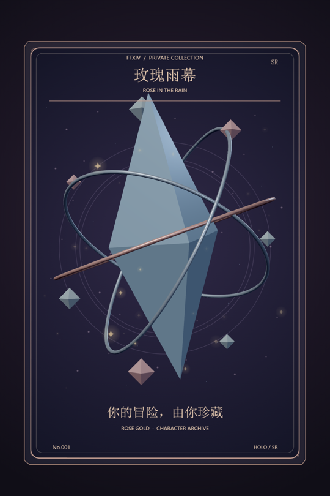

# Ririra Card · 3D 闪卡工作台

在浏览器里制作可自由旋转的角色收藏卡，导入自己的模型，调整卡面并导出 PNG / 循环 GIF。面向 FF14 玩家与角色创作者，也可使用普通 GLB / glTF 模型。

项目附带原创程序生成的水晶示例，不包含游戏角色模型、游戏贴图或作者的私人角色数据。



## 快速开始

安装 [Node.js 20 或更新版本](https://nodejs.org/)，下载本仓库 ZIP 并解压，然后运行：

```sh
npm start
```

打开 <http://127.0.0.1:8773/>。Windows 也可以双击 `启动闪卡.cmd`。不需要执行 `npm install`，浏览器依赖已放在 `vendor/`。

如果端口已经被使用，可在 PowerShell 设置 `$env:PORT='8774'` 后运行 `npm start`，并打开对应端口。关闭运行 `npm start` 的终端即可停止前台服务。

## 怎么制作

1. 初次打开会显示水晶示例。点击“选择文件”导入 GLB；glTF 请同时选择 bin 和贴图，或用“选择文件夹”选择整套资源。
2. 拖动旋转、滚轮缩放、右键平移。侧栏可调整模型位置、大小、朝向与透明度。
3. 选择背景、边框、渲染风格和灯光；编辑标题、副标题、寄语、稀有度及卡背文字。
4. 叠加星芒等特效，选择导出尺寸，再导出 PNG 或循环 GIF。

提供 79 种背景、21 种边框、26 种可叠加特效、5 种人物渲染风格和 5 种打光预设。FF14 主题背景与特效由代码绘制，为同人风格设计。

| 导出格式 | 尺寸 |
| --- | --- |
| PNG | 当前窗口，720×1080、1080×1620、1440×2160、2160×3240、2880×4320 |
| GIF | 360×540、480×720、720×1080、960×1440、1080×1620 |

PNG 适合保存与收藏；发群建议 GIF 720 档。GIF 为 48 帧无限循环，默认 2.4 秒，特效速度会改变循环时长；支持进度和取消。高分辨率会增加显存、耗时与文件体积；GIF 最多 256 色。文字、边框和程序背景按目标尺寸重绘，原始贴图缺失的细节不会因提高导出尺寸而恢复。

## FF14 原始导出材质转换（可选）

普通 GLB / glTF 不需要 Blender。包含 Meddle 材质元数据的 FF14 导出需要在本机烘焙：

1. 准备完整模型导出目录，保留 `cache/` 以及 bin、贴图，勿只选 glTF。
2. 安装 Blender，并使 `blender` 可从终端调用，或在启动服务前设置路径：

   ```powershell
   $env:BLENDER_PATH='D:\Blender\blender.exe'
   npm start
   ```

3. 在工作台点击“选择文件夹”，等待材质转换；完成后可下载打包后的 GLB，之后直接导入。

转换代码适配当前使用的 Blender 5.1 系列，其他版本和未支持的游戏材质可能需要调整。烘焙会冻结模型当前姿态，不提供游戏动作库或表情编辑。`tools/MeddleTools-main/` 保留转换器所需的上游源码、着色节点及许可证。

导入文件由浏览器及本机服务处理，转换结果位于本机 `output/conversions/`。服务只监听 `127.0.0.1`。使用静态服务器也可编辑普通模型；FF14 烘焙需要本仓库的 Node 服务与 Blender。

## 开发与目录

```sh
npm run check
```

- `realtime-viewer.js`：Three.js 场景、相机与导出捕获。
- `card-*.js` / `ff14-*.js`：卡面背景、边框、文字与特效。
- `model-import.js` / `model-lighting.js`：模型导入和打光。
- `png-export.js` / `gif-export.js` / `gif-worker.js`：静态和动画导出。
- `scripts/`：本机服务器、FF14 材质转换和语法检查。
- `demo-assets.js`：原创水晶示例。

设置保存在当前浏览器的 localStorage 中；不同浏览器不会自动同步。尚无项目文件的保存/恢复功能。

## 许可与素材

本项目代码按 **AGPL-3.0-or-later** 开源，见 [LICENSE](LICENSE)。允许使用、修改和分享，分发修改版或提供修改后的网络服务时应按许可证提供相应源码及许可声明。

第三方组件保留各自许可，见 [THIRD_PARTY_NOTICES.md](THIRD_PARTY_NOTICES.md)。FFXIV 及相关名称归相应权利人所有；本项目为非官方同人工具。代码许可证不授予游戏素材、他人角色模型或用户导入内容的权利，请自行准备有权使用的素材。
